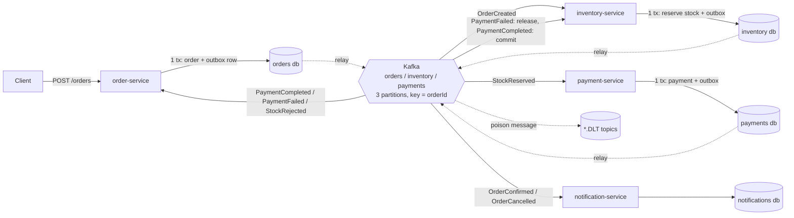

# Event-Driven E-Commerce Microservices

**Four Spring Boot services that keep orders, stock and payments consistent without distributed transactions.** It uses a Kafka choreography saga, a transactional outbox, idempotent consumers and compensation.

[](https://github.com/Alkarim786/event-driven-ecommerce-microservices/actions/workflows/ci.yml)


[](LICENSE)

> Project 9 of Karim's 30 Days, 30 Projects series.

## The problem

Placing an order touches three services, each with its own database: **order** (pricing, status), **inventory** (stock) and **payment** (charging). A single ACID transaction across them would need two-phase commit (2PC). 2PC blocks when the coordinator fails, couples every service's availability, and is not supported by Kafka or most cloud databases.

The usual fix has three failure modes of its own:

| Failure mode | What goes wrong | How this project prevents it |
|---|---|---|
| **Dual write** | The service commits its DB row, then crashes before publishing the event (or the reverse). | **Transactional outbox.** The event is a row written in the *same* local transaction. A relay publishes it later. |
| **Duplicate delivery** | Kafka plus a relay gives at-least-once delivery, so a consumer can see an event twice and charge twice. | **Idempotent consumer.** `processed_messages(consumer_group, event_id)` is inserted in the same transaction as the side effect. |
| **Partial failure** | Stock is reserved, then payment fails. | **Compensation.** `PaymentFailed` makes inventory release the reservation and order cancel. |
| **Race for the last unit** | Concurrent orders oversell. | **Optimistic locking** (`version` column) with retry, all-or-nothing reservation, plus `CHECK (available >= 0)`. |

## Architecture



**Happy path:** `OrderCreated` → `StockReserved` → `PaymentCompleted` → order **CONFIRMED** → `OrderConfirmed` (email) + `StockCommitted` (reserved stock becomes sold).

**Compensation:** `PaymentFailed` → order **CANCELLED** and inventory **releases** the reservation (`StockReleased`). `StockRejected` → order **CANCELLED**; nothing was ever charged.

**Inside every producing service, one local transaction does three things:**
1. checks whether the event was already processed (`processed_messages`),
2. applies the business change,
3. appends the follow-up event to `outbox`.

After commit, a hook wakes that service's `OutboxRelay`. The relay locks unpublished rows (`FOR UPDATE SKIP LOCKED`), sends them to Kafka (`acks=all`, idempotent producer), waits for the acks and marks the rows published. A 100 ms poll is only the fallback.

`GET /orders/{id}` returns a **saga timeline** of every event the order saw. Choreography has no central coordinator, so this is how you see the flow.

## Tech stack

| Tech | Why |
|---|---|
| Java 21, Spring Boot 3.5 | The industry standard for JVM microservices. Records keep the event contracts compact. |
| Apache Kafka 3.9 (KRaft) | Durable, replayable log. Partitioning by `orderId` gives per-order ordering. No ZooKeeper. |
| PostgreSQL 16, one DB per service | Database-per-service isolation. `SKIP LOCKED` and partial indexes power the outbox relay. |
| Spring JDBC (no JPA) | The SQL for outbox locking, compare-and-set state transitions and optimistic locking stays explicit and reviewable. |
| Flyway | Versioned migrations. Shared messaging tables live in `messaging-common`; vendor-specific SQL goes in `db/vendor/{vendor}`. |
| Spring Kafka `DefaultErrorHandler` | Bounded retries, then a dead-letter topic, so one poison message can't block a partition. |
| JUnit 5, H2, Testcontainers, Awaitility | Fast unit tests on H2 (no Docker needed); full-stack tests against real Kafka and Postgres. |
| Micrometer + Prometheus endpoint | `outbox.pending` gauge and `outbox.published` counter per service. |

## Features

**Implemented**
- 4 services (order, inventory, payment, notification) plus a shared `events-contract` (versioned JSON envelope, tolerant reader) and `messaging-common` (outbox, relay, idempotent consumer, Kafka wiring as a Spring Boot auto-configuration).
- Choreography saga with compensation (stock release) and an order state machine: `PENDING → CONFIRMED | CANCELLED`, enforced by a compare-and-set SQL update, so a late event can never flip a terminal order.
- Transactional outbox with a polling relay that is woken on commit, plus retention purge.
- Idempotent consumers, plus business-level guards (one payment per order, reservation state machine). This is defence in depth.
- All-or-nothing multi-item reservation: check every SKU first, then apply optimistic-locked updates, retrying on conflict.
- `Idempotency-Key` header on `POST /orders`, so client retries don't create duplicate orders.
- Dead-letter topics (`*.DLT`). Malformed JSON is never retried.
- **Fault injection:** `OUTBOX_CHAOS_DUPLICATE_RATE` makes the relay publish events twice, to prove exactly-once effects.
- Simulated card gateway with Stripe-style test tokens (`tok_ok`, `tok_decline`, `tok_insufficient_funds`) and the order id as the gateway idempotency key.
- Docker Compose (Kafka KRaft, Postgres, 4 services) and a load generator run inside the compose network.

**Roadmap (not built yet)**
- Orchestration-saga variant (a central coordinator) for a side-by-side comparison.
- Debezium CDC instead of the polling relay (lower latency, no polling load).
- OpenTelemetry tracing across services, with trace id propagated in Kafka headers.
- Retry topics with exponential backoff (non-blocking retries) instead of in-place retries.
- Performance tuning (see the benchmark analysis below): batch listeners and fewer queries per event.

## Key engineering decisions and trade-offs

- **Outbox vs CDC.** A polling relay needs no extra infrastructure and is easy to reason about. It costs polling queries and up to one poll interval of latency, which the commit wake-up hint mostly removes. CDC (Debezium) tails the WAL instead. It's on the roadmap.
- **At-least-once + idempotency = exactly-once *effect*.** If the relay crashes after Kafka acks but before marking rows published, those events are sent again. Consumers insert `(group, event_id)` into `processed_messages` in the same transaction as the effect. A duplicate hits the primary key, the transaction rolls back and the effect is skipped. Only a duplicate on *that* insert counts as "already processed". A unique violation inside the effect is a real error.
- **Ordering.** Every event is keyed by `orderId`, so all events of one order land on one partition, in order. Kafka has **no ordering across topics**. So `StockReserved` carries the amount and payment token from `OrderCreated` (event-carried state transfer), and payment-service never waits for a message on another topic. Multiple relay instances with `SKIP LOCKED` could reorder one aggregate's events, so production should run one relay per service and scale by partitioning.
- **Concurrency on stock.** Reservation is two-phase inside one transaction. First it reads every SKU with its `version` and rejects early if anything is short, so there is never a partial reservation to undo. Then it runs `UPDATE … WHERE sku=? AND version=?`. 0 rows updated means a concurrent change: throw, roll back and retry with jitter. SKUs are processed in sorted order. Release and commit use relative updates (`available = available + ?`), which take a row lock and cannot lose updates.
- **Choreography vs orchestration.** Choreography keeps services decoupled: none knows the whole flow. The cost is visibility, which the timeline endpoint addresses. With more steps, an orchestrator becomes easier to change.
- **Connection-pool deadlock (found by the load test).** `GET /orders/{id}` first ran its item and timeline queries *inside* the parent query's row mapper. Outside a transaction, each nested query borrows a second pooled connection while the first is still held. At 50 concurrent requests and a pool of 20, every connection was held by a request waiting for another, and all requests timed out. The fix runs those queries after the result set closes. A regression test uses a **pool of exactly one connection**, so the bug can't come back silently.
- **Security.** No secrets in code: credentials come from env (`.env.example`). The containers run as a non-root user. The payment gateway is a simulation, and no real card data is handled.

## Quick start

```bash
docker compose up -d --build
```

Services: order `:8081`, inventory `:8082`, payments `:8083`, notifications `:8084`. Kafka is at `localhost:29092` from the host.

```bash
# Place an order (simulatePaymentFailure:true or paymentToken:"tok_decline" exercises compensation)
curl -s -X POST localhost:8081/orders -H 'Content-Type: application/json' -H 'Idempotency-Key: demo-1' \
  -d '{"customerId":"karim","items":[{"sku":"MOUSE-02","quantity":2}],"paymentToken":"tok_ok"}'

curl -s localhost:8081/orders/<orderId>
curl -s localhost:8082/inventory/MOUSE-02
curl -s localhost:8083/payments/<orderId>
curl -s "localhost:8084/notifications?orderId=<orderId>"
```

### Local development

Needs Java 21 and Maven 3.9. Docker is needed only for the integration tests and compose.

```bash
mvn install            # unit tests (H2, no Docker)
mvn install -Pit       # + Testcontainers suite (real Kafka + Postgres)
```

To run a single service from the IDE, start the infrastructure with `docker compose up -d postgres kafka`, then set `KAFKA_BOOTSTRAP_SERVERS=localhost:29092`.

## API reference

| Method | Path | Description |
|---|---|---|
| `POST` | `/orders` | Place an order. Returns **202** `{orderId, status:"PENDING"}`. Optional `Idempotency-Key` header. Unknown SKU → 400. |
| `GET` | `/orders/{id}` | Status, items, total, `sagaLatencyMs`, and timeline. |
| `GET` | `/inventory`, `/inventory/{sku}` | `available`, `reserved`, `sold`, `version`. |
| `POST` | `/inventory/{sku}/restock` | `{quantity}`: admin restock (relative update). |
| `GET` | `/payments/{orderId}` | Payment status and failure reason. |
| `GET` | `/notifications?orderId=` | Messages sent to the customer. |
| `GET` | `/actuator/health`, `/actuator/prometheus` | Health and metrics, on every service. |

Shape of a `GET /orders/{id}` response after a declined payment (values shortened):

```json
{
  "orderId": "62e02f5a-…", "status": "CANCELLED", "totalCents": 24999500,
  "cancelReason": "payment failed: card_declined", "sagaLatencyMs": …,
  "timeline": [
    {"event": "OrderCreated"}, {"event": "StockReserved"}, {"event": "PaymentFailed", "detail": "card_declined"},
    {"event": "OrderCancelled"}, {"event": "StockReleased", "detail": "compensated"}
  ]
}
```

**Kafka topics:** `orders.events`, `inventory.events` and `payments.events` (3 partitions each, keyed by orderId), plus `*.DLT`.

## Testing

**50 tests in total.** 44 run on every build with no Docker; the 6 in the Testcontainers suite need Docker (`-Pit`).

| Suite | Where it runs | What it proves |
|---|---|---|
| `EventCodecTest` (3) | everywhere | Envelope round-trip, tolerant reader, poison messages rejected with a typed exception. |
| `OutboxRelayTest` (7) | H2 | Rolled-back business transaction → no event; commit order and keys preserved; broker failure → batch retried (at-least-once); chaos duplicates; purge; commit wake-up. |
| `IdempotentConsumerTest` (6) | H2 | Same event twice → one effect; concurrent duplicates (16 threads) → one effect; failed effect rolls back the marker; unique violation inside the effect is not treated as a duplicate; optimistic-lock retry. |
| Service handler tests (23) | H2 | Order pricing, idempotency key, state machine and late events; all-or-nothing reservation, release and commit exactly once, 24 threads racing for 3 units; payment decline and limits, single charge; one notification per event; pool-of-1 regression test. |
| `InMemorySagaTest` (5) | H2, in-process | The **real** handlers, outboxes and relays of all 4 services on an in-memory bus: happy path, compensation, out-of-stock, a **redelivery storm** (each message ~6× delivered), and a flash-sale race (40 buyers, 50 units, 2 each → exactly 25 confirmed). |
| `KafkaSagaIT` (6) | **Docker:** Kafka + Postgres via Testcontainers | All 4 Spring Boot apps in one JVM, relays at a **50% chaos duplicate rate**: happy path over REST, compensation, 20 concurrent buyers for 5 units, Idempotency-Key, poison message → `orders.events.DLT` without blocking the partition, one payment and one notification per order. |

All 50 pass locally (Windows 11, Docker Desktop) and run in GitHub Actions. CI runs `mvn verify -Pit`, then builds the four images and smoke-tests the full compose stack with a 200-order load test.

## Benchmarks

**Setup:** AMD Ryzen 5 7520U (4 cores / 8 threads), 16 GB RAM, Windows 11, Docker Desktop on WSL2 (VM sees ~7.4 GB). Everything runs on the one laptop: Kafka, Postgres, 4 services (512 MB limit each) and the load generator. The generator ([`scripts/loadtest.py`](scripts/loadtest.py)) runs inside the compose network, which avoids Docker Desktop's port-forwarding overhead.

**Workload:** 1,000 orders, 50 in flight. Each order has 1–3 regular SKUs; 20% also want 1 unit of `HOT-DROP` (only 50 in stock), and 5% use a declining card. Each worker POSTs, then polls `GET /orders/{id}` until the order is terminal.

**Saga latency** is measured server-side (`completed_at − created_at`), so it has no polling bias.

| Run | Throughput | Saga p50 | p95 | p99 | Errors | Oversold units | Duplicate effects |
|---|---|---|---|---|---|---|---|
| Client polls every 20 ms | 11.5 orders/s | 2,837 ms | 7,063 ms | 9,070 ms | 0 | **0** | **0** |
| Client polls every 200 ms | **17.8 orders/s** | 1,896 ms | 5,190 ms | 6,164 ms | 0 | **0** | **0** |
| 200 ms + **30% of events published twice** | 17.5 orders/s | 2,087 ms | 4,310 ms | 4,944 ms | 0 | **0** | **0** |

Every run: 824 confirmed, 176 cancelled. `HOT-DROP` sold exactly 50/50. `available + reserved + sold` was unchanged for every SKU and `reserved` was 0 at the end. Every order had exactly one notification, and every order that reached payment had exactly one matching payment record.

**Reading the numbers honestly.** Correctness held under every condition, including injected duplicates. Raw throughput is modest. Everything shares 4 cores, and each saga is ~5 Kafka hops, each with a DB transaction of 3–6 statements. Cutting the generator's own polling (20 ms → 200 ms) made sagas ~35% faster, which shows the box is CPU-bound rather than limited by the design. Next steps for real numbers: separate hosts, batch listeners and fewer statements per event.

Reproduce:

```bash
docker compose down -v && docker compose up -d --build
POLL_MS=200 docker compose --profile bench run --rm -e POLL_MS loadtest
# with fault injection:
docker compose down -v && OUTBOX_CHAOS_DUPLICATE_RATE=0.3 docker compose up -d
POLL_MS=200 docker compose --profile bench run --rm -e POLL_MS loadtest
```

## Project structure

```
.
├── events-contract/        EventEnvelope, payload records, topic names, EventCodec
├── messaging-common/       OutboxWriter, OutboxRelay, IdempotentConsumer, Kafka + DLT auto-config
│   └── src/main/resources/db/{messaging,vendor/postgresql}/   shared migrations
├── order-service/          REST API, pricing, order state machine, saga timeline
├── inventory-service/      optimistic-locked reservations, release/commit
├── payment-service/        simulated gateway (test tokens), one payment per order
├── notification-service/   one email per terminal event
├── system-tests/           InMemorySagaTest (in-process) + KafkaSagaIT (Testcontainers)
├── scripts/loadtest.py     end-to-end load test + consistency audit (stdlib only)
├── docker/postgres-init.sql  one database per service
├── Dockerfile              one multi-stage build for all services (ARG SERVICE)
├── docker-compose.yml      Kafka (KRaft) + Postgres + 4 services (+ bench profile)
└── .github/workflows/ci.yml
```

## License

MIT, see [LICENSE](LICENSE). Project 9 of Karim's 30 Days, 30 Projects series.
